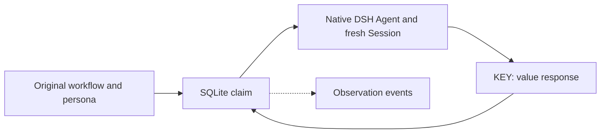

# Antfarm implementation

English | [中文](DESIGN.zh.md)

## Summary

Antfarm retains the original workflow method and SQLite business state while DSH executes its agents. Stable identities and personas belong to Antfarm; runtime Agents and fresh Sessions belong to DSH. This reference describes the `0.3.0` development implementation on DSH `0.2.2-rc.1`; [README](README.md) owns configuration and user operations.

## Table of Contents

- [Identity and execution](#identity)
- [Business state](#state)
- [Recovery and ownership](#recovery)
- [Client and packaging](#client)
- [Verification](#verification)
- [Dev Note](#dev-note)

-----

## Identity and execution

The [loader](src/workflow/loader.ts) reads original YAML and confined persona resources. A workflow-qualified agent owns its name, `IDENTITY.md`, `SOUL.md`, `AGENTS.md`, workspace, role, model and optional skills. The [adapter](src/runtime/agents.ts) reserves each attempt’s native Session ID before startup, maps it to that identity and renders its persona through DSH’s system-prompt extension. This follows [DS-Bot](https://github.com/Fei2411/DS-Bot)’s identity/Session separation.

Every step or story attempt starts a fresh caller-delivered local activation with the shared `standard` composition. Role restrictions mask visible tools and guard actual dispatch. Persona resources update under the claimed agent’s exclusive slot; conflicting local edits remain intact and stop that attempt. Declared skills resolve through native providers; missing optional skills are disclosed, matching original provisioning.

## Business state

The [schema](src/persistence/schema.ts) preserves the original `runs`, `steps` and `stories` columns. The [database](src/persistence/database.ts) commits admission, claim, output/context, story verification, retry and resume transitions atomically. Additional `dsh_runs` and `dsh_attempts` associate native owners and exact claimant Sessions; a separate host association excludes concurrent native dispatchers. They do not replace the original business tables.

Worker replies use original multiline `KEY: value` text and `STORIES_JSON`. Loop completion marks a story done before its referenced verifier runs; rejection retries that story. Resume preserves consumed story retries. Native deadlines feed the original abandonment budget after confirmed child exit; single attempts fail at the fifth abandonment. JSONL events are best-effort observation, emitted only after a successful transaction.

The Host retains original reported-result semantics. It does not convert a reply into independent test or GitHub acceptance. Single-step `on_fail` declarations remain original workflow metadata; verification-specific story retry follows the original worker protocol. [PARITY](PARITY.md) records intentional native differences and evidence limits.

## Recovery and ownership

The initiating root Session owns reads and controls. [Native owner recovery](src/runtime/owner.ts) restores its persisted composition without a parent model turn. Startup dispatches inactive work that has no open attempt; an unmatched native attempt stays interrupted. Explicit guidance is required before recovery can repeat uncertain effects. SQLite and fresh Sessions do not supply exactly-once execution.

Each stable agent permits one active native attempt across runs. Host/owner capacity and model-free polling wait for occupied agents. Jobs own dispatch; a rejected Job admission leaves an inspectable interrupted Run. Cancellation, owner shutdown and plugin disposal wait for exact activation teardown. Teardown failure retains interruption instead of reporting confirmed cancellation or starting another worker.

Agent workspaces remain shared identity resources. Completed loop progress is archived; the Host does not remove per-agent directories. [Historical reads](src/persistence/legacy.ts) inspect attributable complete-prefix journal facts without rewriting, migrating or replaying old runs. Best-effort webhook delivery is separate from SQL acceptance and drains at host shutdown.

## Client and packaging

The [Studio gateway](src/studio-host/index.ts) checks selected Session resources and expected Run/source revisions. The [client](src/client/mount.tsx) reuses native sidebar, board, navigation, locale and feedback components. It shows original step state/output and stories; resume and cancel correspond to runtime operations. Shared workspaces expose no cleanup button or additional retry grant.

The independent package contains prebuilt Host/Web entries, generated Remotes, original resources and their MIT attribution. [Composition tests](tests/composition.spec.ts) load built exports in plain Node and verify registration/disposal. The parent repository records only the plugin submodule pointer and integration documentation.

## Verification

Owner-local tests cover unchanged original resources, SQL transitions, late results, role policy, fresh personas/Sessions, waiting, cancellation, historical preservation and webhooks. Real-host evidence and remaining platform/model checks belong to [acceptance scope](PARITY.md#acceptance-scope).

-----

## Dev Note

The current design rationale is the [original agents/storage note](https://github.com/winterhuan/dsh-creative/blob/develop/.agents/notes/implemented/architecture/2026-11-08-antfarm-original-agents-and-storage.md).
