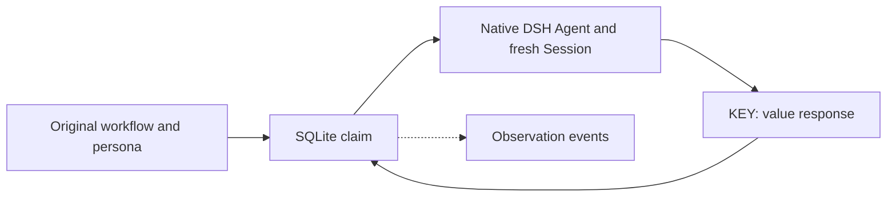

# Antfarm 实现

[English](DESIGN.md) | 中文

## 概述

Antfarm 保留原版工作流方法与 SQLite 业务状态，由 DSH 执行 agent。稳定身份与人设归 Antfarm 管理；运行时 Agent 和全新 Session 归 DSH 管理。此参考说明 DSH `0.2.2-rc.1` 上的 `0.3.0` 开发实现；[README](README.zh.md)维护配置和用户操作。

## 目录

- [身份与执行](#identity)
- [业务状态](#state)
- [恢复与归属](#recovery)
- [客户端与打包](#client)
- [验证](#verification)
- [开发备注](#dev-note)

-----

## 身份与执行

[加载器](src/workflow/loader.ts)读取原版 YAML 与受限人设资源。工作流限定的 agent 拥有姓名、`IDENTITY.md`、`SOUL.md`、`AGENTS.md`、工作区、角色、模型和可选 skill。[适配器](src/runtime/agents.ts)在启动前保留各尝试的原生 Session ID，将其关联到该身份，并通过 DSH 系统提示词扩展呈现人设。这沿用 [DS-Bot](https://github.com/Fei2411/DS-Bot) 对身份与 Session 的分离。

每个步骤或故事尝试使用共用 `standard` 能力组合，创建全新、结果交给调用方的本地激活。角色限制同时屏蔽可见工具并守卫实际派发。人设资源在所领取 agent 的排他槽位内更新；冲突的本地修改保持不变并阻止此次尝试。声明的 skill 通过原生 provider 解析；缺失的可选 skill 会明确告知，与原版安装行为一致。

## 业务状态

[Schema](src/persistence/schema.ts)保留原版 `runs`、`steps` 和 `stories` 列。[数据库](src/persistence/database.ts)原子提交准入、领取、输出／上下文、故事验证、重试与恢复状态转换。附加 `dsh_runs` 和 `dsh_attempts` 关联原生 owner 与确切领取者 Session；单独的宿主关联排除并发原生调度器。它们不替代原版业务表。

Worker 回复使用原版多行 `KEY: value` 文本和 `STORIES_JSON`。循环完成先将故事标为 done，再运行所引用的 verifier；拒绝后重试该故事。恢复保留已消耗的故事重试次数。原生时限在确认子会话退出后计入原版放弃预算；单步尝试在第五次放弃时失败。JSONL 事件是尽力写入的观察记录，仅在事务成功后发出。

宿主保留原版报告结果语义，不将回复转换为独立测试或 GitHub 验收。单步 `on_fail` 声明保留为原版工作流元数据；验证相关的故事重试沿用原版 worker 协议。[PARITY](PARITY.zh.md)记录原生适配差异和证据范围。

## 恢复与归属

发起任务的根 Session 拥有读取和控制权。[原生 owner 恢复](src/runtime/owner.ts)重建其持久能力组合，无需父级模型回合。启动时调度没有开放尝试的非活跃任务；未匹配的原生尝试保留为中断状态。恢复可能重复不确定效果，因此需要显式指导。SQLite 和全新 Session 不提供恰好一次执行。

每个稳定 agent 在不同运行间只允许一个活跃原生尝试。宿主／owner 容量与无模型轮询等待被占用的 agent。Jobs 拥有调度权；Job 准入被拒绝后保留可查看的中断 Run。取消、owner 停止和插件释放均等待确切激活的释放。释放失败保留为中断状态，不报告已确认取消，也不启动另一 worker。

Agent 工作区是共享身份资源。完成的循环进度会归档；宿主不移除逐 agent 目录。[历史读取](src/persistence/legacy.ts)查看可确认归属的日志完整前缀，不重写、迁移或重放旧运行。尽力 webhook 投递与 SQL 接受独立，并在宿主关闭时排空。

## 客户端与打包

[Studio gateway](src/studio-host/index.ts)检查所选 Session 资源及预期 Run／源码修订。[客户端](src/client/mount.tsx)复用原生侧栏、看板、导航、语言与反馈组件，展示原版步骤状态／输出和故事；恢复、取消对应运行时操作。共享工作区不提供清理按钮或追加重试授权。

独立包包含预构建 Host／Web 入口、生成 Remote、原版资源及其 MIT 署名。[装配测试](tests/composition.spec.ts)在普通 Node 中加载构建后的导出，验证注册与释放。父仓库仅记录插件子模块指针和集成文档。

## 验证

所属包内测试覆盖原版资源不变、SQL 状态转换、迟到结果、角色策略、全新人设／Session、等待、取消、历史保护与 webhook。真实宿主证据及剩余平台／模型检查见[验收范围](PARITY.zh.md#acceptance-scope)。

-----

## 开发备注

当前设计取舍见[原版 agent／存储 note](https://github.com/winterhuan/dsh-creative/blob/develop/.agents/notes/implemented/architecture/2026-11-08-antfarm-original-agents-and-storage.zh.md)。
